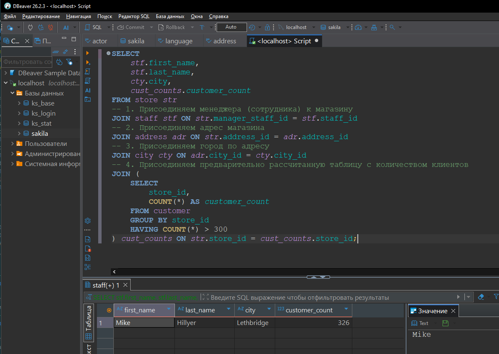
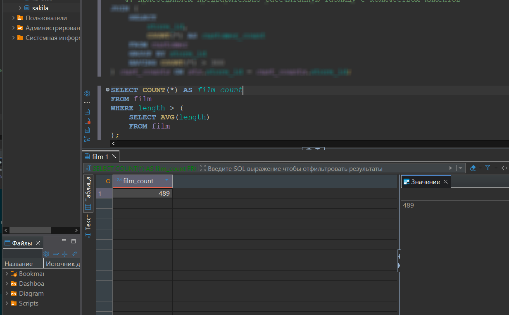
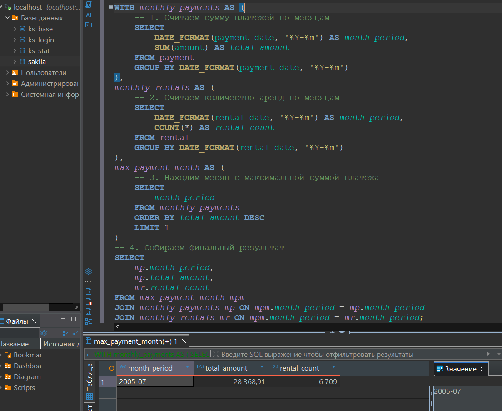

# db-sql_hw
Домашнее задание к занятию "Расширенные возможности SQL"
<Белопух У.Н.>


### Задание 1

Одним запросом получите информацию о магазине, в котором обслуживается более 300 покупателей, и выведите в результат следующую информацию:
- фамилия и имя сотрудника из этого магазина;
- город нахождения магазина;
- количество пользователей, закреплённых в этом магазине.

```
SELECT
    stf.first_name,
    stf.last_name,
    cty.city,
    cust_counts.customer_count
FROM store str
-- 1. Присоединяем менеджера (сотрудника) к магазину
JOIN staff stf ON str.manager_staff_id = stf.staff_id
-- 2. Присоединяем адрес магазина
JOIN address adr ON str.address_id = adr.address_id
-- 3. Присоединяем город по адресу
JOIN city cty ON adr.city_id = cty.city_id
-- 4. Присоединяем предварительно рассчитанную таблицу с количеством клиентов
JOIN (
    SELECT
        store_id,
        COUNT(*) AS customer_count
    FROM customer
    GROUP BY store_id
    HAVING COUNT(*) > 300
) cust_counts ON str.store_id = cust_counts.store_id;
```


### Задание 2

Получите количество фильмов, продолжительность которых больше средней продолжительности всех фильмов.

```
SELECT COUNT(*) AS film_count
FROM film
WHERE length > (
    SELECT AVG(length)
    FROM film
);
```

### Задание 3

Получите информацию, за какой месяц была получена наибольшая сумма платежей, и добавьте информацию по количеству аренд за этот месяц.

```
WITH monthly_payments AS (
    -- 1. Считаем сумму платежей по месяцам
    SELECT
        DATE_FORMAT(payment_date, '%Y-%m') AS month_period,
        SUM(amount) AS total_amount
    FROM payment
    GROUP BY DATE_FORMAT(payment_date, '%Y-%m')
),
monthly_rentals AS (
    -- 2. Считаем количество аренд по месяцам
    SELECT
        DATE_FORMAT(rental_date, '%Y-%m') AS month_period,
        COUNT(*) AS rental_count
    FROM rental
    GROUP BY DATE_FORMAT(rental_date, '%Y-%m')
),
max_payment_month AS (
    -- 3. Находим месяц с максимальной суммой платежа
    SELECT
        month_period
    FROM monthly_payments
    ORDER BY total_amount DESC
    LIMIT 1
)
-- 4. Собираем финальный результат
SELECT
    mp.month_period,
    mp.total_amount,
    mr.rental_count
FROM max_payment_month mpm
JOIN monthly_payments mp ON mpm.month_period = mp.month_period
JOIN monthly_rentals mr ON mpm.month_period = mr.month_period;
```

