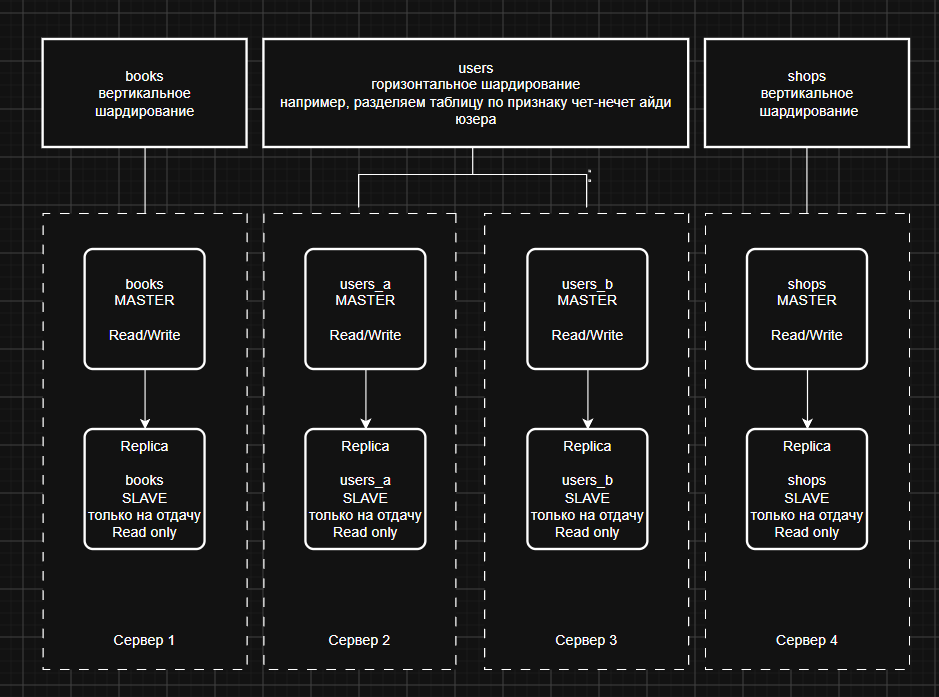

# db-sql_hw
Домашнее задание к занятию "Репликация и масштабирование. Часть 2"
<Белопух У.Н.>

### Задание 1

Опишите основные преимущества использования масштабирования методами:

- активный master-сервер и пассивный репликационный slave-сервер;
- master-сервер и несколько slave-серверов;

*Дайте ответ в свободной форме.*

---
Эти методы решают разные проблемы: первый больше про безопасность и выживаемость, а второй — про скорость и распределение нагрузки

Активный master-сервер и пассивный репликационный slave-сервер - работает всегда только один (master), а второй (slave) просто «на лету» получает все изменения.
Основные преимущества:
 - Высокая отказоустойчивость, если главный сервер упадет по какой-либо причине, то пассивный сервер готов практически мгновенно подменить его и стать новым Master. Простой системы будет минимальным
 - Простота обслуживания, можно спокойно отключать пассивный сервер, обновлять на нем операционную систему или менять железо или делать что-то еще. При этом пользователи даже ничего не заметят. Потом включаем его обратно, он догоняет Master по репликации, и можно проделать то же самое с Master-сервером
 - Бекапы — это тяжелый процесс, который может тормозить базу. В этой схеме можно делать бэкапы с пассивного слейва, вообще не трогая мастер

Master-сервер и несколько slave-серверов - как вариант, есть один Master, который пишет (принимает изменения) и есть слейвы которые эти изменения принимают и раздают принимая на себя нагрузку по отдаче
Основные преимущества:
 - Масштабирование на чтение: В большинстве интернет-проектов (соцсети, интернет-магазины, СМИ) пользователи гораздо чаще читают информацию (смотрят посты, ищут товары), чем пишут (оставляют комментарии, делают заказы). Можно перенаправить все запросы на чтение (SELECT) на Slave-серверы, разгрузив основной.
 - Высокая производительность - поскольку Master занимается только записью, а слейвы — только чтением, такое разграничение упрощает и ускоряет работу
 - Географическое распределение - можно поставить по одному Slave-серверу в разных частях мира (например, в Европе, Азии и Америке). Местные пользователи будут мгновенно получать данные с ближайшего к ним сервера, а Master будет спокойно стоять в одном центральном дата-центре.
 - Изоляция: можно выделить slave для внутренней работы, например для разгрузки в разные бухгалтерии и статистики, не будут мешать основной деятельности выгружая гигабайты таблиц

---

### Задание 2

Разработайте план для выполнения горизонтального и вертикального шаринга базы данных. База данных состоит из трёх таблиц:

- пользователи,
- книги,
- магазины (столбцы произвольно).

Опишите принципы построения системы и их разграничение или разбивку между базами данных.

*Пришлите блоксхему, где и что будет располагаться. Опишите, в каких режимах будут работать сервера.*

---
Комбинированный подход:
1. Вертикальный шардинг: Это разделение системы по функциональному признаку (таблицам). Вместо хранения всех сущностей на одном сервере, мы разносим логически слабо связанные таблицы на отдельные серверные узлы. Это исключает конкуренцию таблиц за общие ресурсы процессора и диска.
2. Горизонтальный шардинг: Это разделение конкретной таблицы на основе определенного ключа. Применяю его к самой быстрорастущей таблице — «Пользователи», чтобы распределить аккаунты между двумя серверами.

Масштабирование структуры таблиц (Пользователи - users, Книги - books, Магазины - shops) будет реализовано по следующей схеме:

 - users:	Горизонтальный	Делится на два шарда по ID пользователя (чётные/нечётные или диапазоны).
 - books:	Вертикальный	Выносится целиком на отдельный сервер.
 - shops:	Вертикальный	Выносится целиком на отдельный сервер.

Для обеспечения отказоустойчивости и высокой скорости чтения каждый выделенный сервер («мастер») усиливается репликацией

Блок-схема

